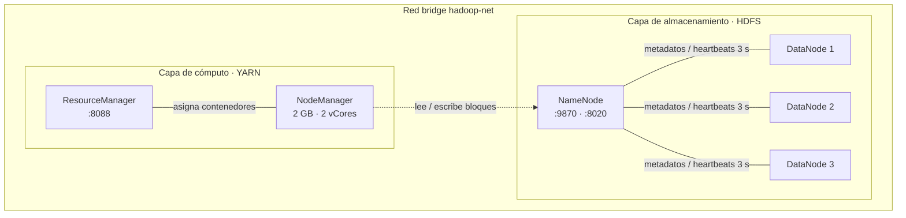

# IABD-5075 · Laboratorio Apache Hadoop multi-nodo con Docker

Despliegue y auditoría de un **clúster distribuido Apache Hadoop 3.3.6** sobre contenedores Docker:
almacenamiento resiliente en **HDFS**, simulación de **tolerancia a fallos** y cómputo **MapReduce sobre YARN**.

> Módulo 5074/5075 · Máster IA y Big Data · Laboratorio (AEE)

---

## 1. Ficha resumen de la arquitectura

| Elemento | Valor |
|---|---|
| Imagen base | `apache/hadoop:3` (Hadoop 3.3.6) |
| Orquestación | Docker Compose v2 (`docker/docker-compose.yml`) |
| Red | `hadoop-net` (bridge aislada, subred `172.18.0.0/16`) |
| Nodos maestros | 1 × NameNode (HDFS) · 1 × ResourceManager (YARN) |
| Nodos trabajadores | 3 × DataNode (HDFS) · 1 × NodeManager (YARN) |
| Tamaño de bloque | **64 MiB** (`dfs.blocksize=67108864`) |
| Factor de replicación | **R = 2** (`dfs.replication=2`) |
| Recursos YARN | 2048 MB y 2 vCores por NodeManager |
| Contenedores MapReduce | AM, map y reduce de 512 MB (asignación mínima 256 MB) para evitar el bloqueo del AM en un nodo de 2 GB |
| Consolas web | NameNode → <http://localhost:9870> · ResourceManager → <http://localhost:8088> |



| Servicio | Contenedor | Rol | Puerto publicado |
|---|---|---|---|
| `namenode` | namenode | Maestro HDFS: espacio de nombres y mapa de bloques | 9870 |
| `datanode1..3` | datanode1..3 | Trabajadores HDFS: almacenan las réplicas de bloques | — |
| `resourcemanager` | resourcemanager | Maestro YARN: planifica recursos del clúster | 8088 |
| `nodemanager` | nodemanager | Trabajador YARN: lanza contenedores Map/Reduce | — |

## 2. Requisitos previos

- Docker Desktop (o Docker Engine + Compose v2) en ejecución. En Windows: WSL2 y virtualización (VT-x) activada en la BIOS.
- Git y una cuenta de GitHub.
- ≥ 6 GB de RAM libre y ≥ 5 GB de disco libre para la imagen y los datos.

## 3. Instrucciones de arranque

```bash
git clone https://github.com/<tu-usuario>/IABD-5075-LabHadoop-Apellido1-Apellido2.git
cd IABD-5075-LabHadoop-Apellido1-Apellido2/docker

docker compose config --quiet     # valida la sintaxis del IaC
docker compose up -d              # levanta los 6 servicios
docker compose ps                 # todos deben aparecer "Up"
```

Verificación rápida:

```bash
docker exec -it namenode hdfs dfsadmin -report       # "Live datanodes (3)"
# Navegador: http://localhost:9870 (pestaña Datanodes) y http://localhost:8088
```

Pruebas del laboratorio (dentro de `docker exec -it namenode bash`):

```bash
# Ingesta y auditoría de bloques
dd if=/dev/urandom of=/tmp/telemetria_bruta.dat bs=1M count=150
hdfs dfs -mkdir -p /datos/auditoria
hdfs dfs -put /tmp/telemetria_bruta.dat /datos/auditoria/
hdfs fsck /datos/auditoria/telemetria_bruta.dat -files -blocks -locations

# Tolerancia a fallos (desde el anfitrión: docker stop datanode2 / docker start datanode2)
hdfs dfs -cat /datos/auditoria/telemetria_bruta.dat | wc -c     # 157286400

# MapReduce sobre YARN
hadoop jar $HADOOP_HOME/share/hadoop/mapreduce/hadoop-mapreduce-examples-*.jar \
  wordcount /datos/wordcount/input /datos/wordcount/output
hdfs dfs -cat /datos/wordcount/output/part-r-00000
```

Parada y limpieza:

```bash
docker compose down -v
```

## 4. Resultados obtenidos

| Prueba | Resultado |
|---|---|
| Despliegue | 6/6 contenedores `Up`, 3 DataNodes *In Service* |
| Ingesta 150 MiB | 3 bloques (64 + 64 + 22 MiB) × R=2 = 6 réplicas físicas · fsck `HEALTHY` |
| Caída de `datanode2` | *Stale* a los ~30 s, *Dead* a los ~630 s, re-replicación automática, lectura íntegra de 157 286 400 bytes |
| WordCount sobre YARN | `FINISHED / SUCCEEDED`, salida en `part-r-00000` |

El detalle, las salidas de terminal y las respuestas a las cuatro cuestiones técnicas están en el informe PDF.

## 5. Estructura del repositorio

```
IABD-5075-LabHadoop-Apellido1-Apellido2/
├── .gitignore                       # excluye *.dat, *.log, tmp/ y basura del SO
├── README.md
├── docker/
│   ├── config                       # parámetros core/hdfs/mapred/yarn-site
│   └── docker-compose.yml           # topología 1 NN + 3 DN + 1 RM + 1 NM
├── evidencias/
│   ├── 01_namenode_ui_9870.png
│   ├── 02_hdfs_fsck_bloques.png
│   ├── 03_simulacion_fallo_datanode2.png
│   └── 04_yarn_wordcount_8088.png
└── informe/
    └── Apellido1_Apellido2_InformeLabHadoop.pdf
```

> El fichero de prueba de 150 MiB (`telemetria_bruta.dat`) solo existe dentro del contenedor y está excluido por `.gitignore`, porque supera el límite de 100 MiB por fichero de GitHub.

## 6. Autoría

- **Autor:** Pablo Apellido1 Apellido2
- **Programa:** Máster en Inteligencia Artificial y Big Data, Centro FP Superior Cámara de Comercio de Sevilla
- **Módulo:** 5074/5075 · Big Data Aplicado
- **Fecha:** noviembre de 2026
